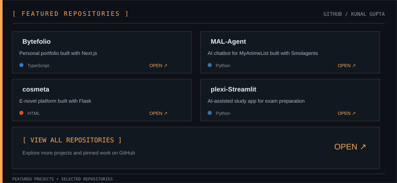

<picture>
  <source media="(prefers-color-scheme: dark)" srcset="https://raw.githubusercontent.com/kunalgupta25/kunalgupta25/gitascii/profiles/default/dark.svg">
  <source media="(prefers-color-scheme: light)" srcset="https://raw.githubusercontent.com/kunalgupta25/kunalgupta25/gitascii/profiles/default/light.svg">
  
</picture>

---

## 🧰 Tech Stack

## 📌 Featured Repositories

  <a href="https://github.com/KunalGupta25/Bytefolio">Bytefolio</a> ·
  <a href="https://github.com/KunalGupta25/MAL-Agent">MAL-Agent</a> ·
  <a href="https://github.com/KunalGupta25/cosmeta">cosmeta</a> ·
  <a href="https://github.com/KunalGupta25/plexi-Streamlit">plexi-Streamlit</a>

