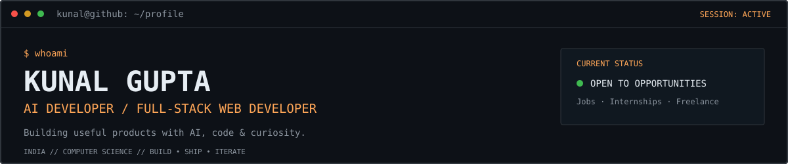
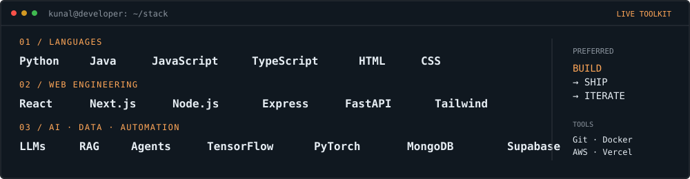
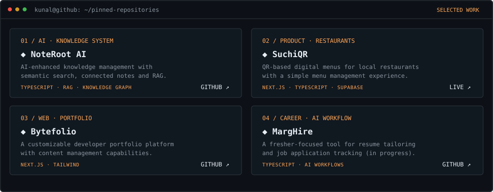
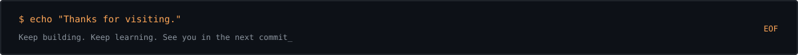

<!--
  Kunal Gupta | GitAscii-inspired GitHub Profile
  Source layout: gitascii-template.json
  Custom README widgets: assets/tech-stack.svg and assets/featured-repos.svg
  GitHub renders SVG/Markdown; it does not execute JavaScript inside README files.
-->

<div align="center">



<p>
  <a href="mailto:kunalgupta250119@gmail.com"></a>
  <a href="https://www.linkedin.com/in/kunalgupta25/"></a>
  <a href="https://github.com/KunalGupta25"></a>
  <a href="https://kunalgupta25.me"></a>
</p>


</div>

---

## <code>$ whoami</code>

```text
Kunal Gupta
Computer Science Student | AI Developer | Full-Stack Web Developer
Location : India
Focus    : LLMs · RAG · AI Agents · Web Applications · Automation
Status   : Open to jobs, internships and freelance projects
```

Hey! I'm **Kunal**, a developer interested in building practical products at the intersection of **AI and web development**.

- I build AI-powered applications using LLMs, RAG, agents, and automation workflows.
- I enjoy developing end-to-end web products, from clean interfaces to backend APIs.
- I learn by shipping projects, experimenting with tools, and solving real problems.
- Open to **full-time opportunities, internships, freelance projects, and open-source collaboration**.

> **Build → Ship → Iterate.** I like turning useful ideas into working products.

## <code>$ cat tech-stack.json</code>

<div align="center">



</div>

<details>
<summary><b>Stack details</b></summary>

- **Languages:** Python, Java, JavaScript, TypeScript, HTML, CSS
- **Frontend & backend:** React, Next.js, Node.js, Express, FastAPI, Tailwind CSS
- **AI & data:** LLMs, RAG, AI agents, TensorFlow, PyTorch, MongoDB, Supabase
- **Tools:** Git, Docker, Linux, AWS, Vercel, Cloudflare, n8n

</details>

---

## <code>$ gh pinned --limit 4</code>

<div align="center">



</div>

The cards above are refreshed daily from the public pinned repositories on my GitHub profile. Explore the repositories directly:

| Project | What it does |
|:--|:--|
| [NoteRoot AI](https://github.com/KunalGupta25/NoterootAI) | AI-enhanced knowledge management with semantic search, connected notes and RAG |
| [SuchiQR](https://suchi-qr.vercel.app) | QR-based digital menus and menu management for local restaurants |
| [Bytefolio](https://github.com/KunalGupta25/Bytefolio) | Customizable developer portfolio platform |
| [MargHire](https://github.com/KunalGupta25/MargHire) | Fresher-focused resume tailoring and job application tracking project |

---

## <code>$ github --telemetry</code>

| Metric | Details |
|:--|:--|
| Primary focus | AI engineering & full-stack web development |
| Current interests | LLM applications, RAG, AI agents, automation |
| Building mindset | Practical products, clean interfaces, reliable APIs |
| Collaboration | Open-source, freelance, internships and job opportunities |
| Contact | [Email](mailto:kunalgupta250119@gmail.com) · [LinkedIn](https://www.linkedin.com/in/kunalgupta25/) |

## <code>$ github --stats</code>

<div align="center">
  
  
</div>

<div align="center">
  
</div>

## <code>$ git log --activity</code>

<div align="center">
  
  
</div>

---

## <code>$ connect --socials</code>

<div align="center">
  <a href="https://www.linkedin.com/in/kunalgupta25/"></a>
  <a href="https://dev.to/kunalgupta25"></a>
  <a href="https://www.hackerrank.com/profile/kunalgupta25"></a>
  <a href="https://kunalgupta25.me"></a>
  <a href="mailto:kunalgupta250119@gmail.com"></a>
</div>

## <code>$ status --opportunities</code>

| Opportunity | Status |
|:--|:--|
| Full-time roles | Open to opportunities |
| Internships | Actively looking |
| Freelance projects | Available for discussions |
| Open-source collaboration | Always welcome |

<div align="center">

**Have an interesting problem or opportunity? Let's build something together.**

<a href="mailto:kunalgupta250119@gmail.com"></a>
<a href="https://www.linkedin.com/in/kunalgupta25/"></a>



</div>
